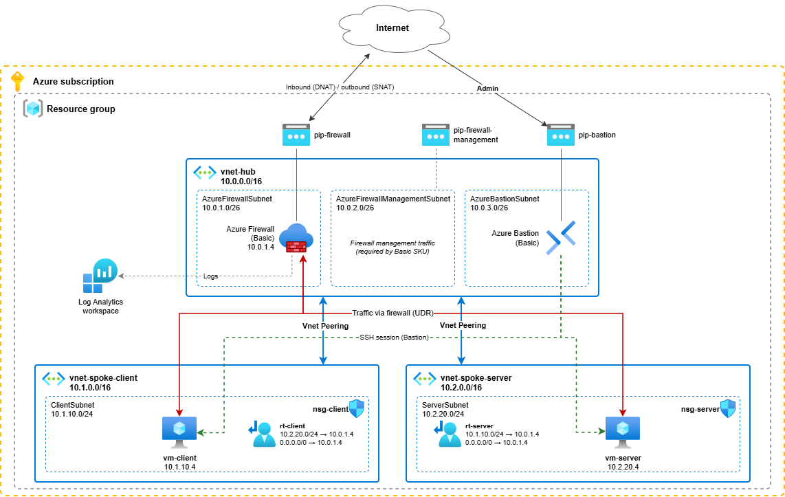

# Azure Firewall Lab

This repository contains a small hub-spoke lab for practising Azure Firewall management and Azure networking with Terraform. 

> [!WARNING]
> This is a training environment. Do not use it as an example of a production template as-is.
> - The outbound rules allow TCP 80/443 from both spokes to **any** destination, including public internet outside the environment.
> - The optional DNAT rule opens an SSH port on the firewall's public IP to the internet (limited to your own IP address).
> - Terraform state is kept in a local file, which contains resource details in plain text.
>
> The lab also costs money while it is running. Run `terraform destroy` when you are done. See [Costs and clean-up](#costs-and-clean-up).


## Architecture

The image below shows the final architecture of the environment:



### Overview

* Azure Firewall (Basic) is deployed in a hub virtual network, with two spoke virtual networks hosting one Linux VM each.
* Bastion is used for VM access. It connects to the VMs directly over the peering, not through the firewall.
* All traffic between the spokes and from the spokes to the internet is routed through the firewall using route tables (UDRs).
* Default outbound access is disabled on the spoke subnets, so the VMs can reach the internet only through the firewall.
* The spokes are peered with the hub only (no spoke-to-spoke peering).
* Network security groups on both spoke subnets add a second layer of filtering: SSH is allowed only from Bastion, and the server also accepts TCP 443 and 3306 from the client subnet.
* There is no inbound access from the internet by default. An optional DNAT rule for SSH can be enabled (see [Optional: inbound SSH through the firewall (DNAT)](#optional-dnat)).
* The firewall sends its network rule and NAT rule logs to resource-specific tables in Log Analytics.

<details>
<summary><h3>Networks and IP addresses</h3> (click to expand)</summary>

* `vnet-hub` (`10.0.0.0/16`)
  * `AzureFirewallSubnet` (`10.0.1.0/26`): Azure Firewall
  * `AzureFirewallManagementSubnet` (`10.0.2.0/26`): firewall management traffic
  * `AzureBastionSubnet` (`10.0.3.0/26`): Azure Bastion
* `vnet-spoke-client` (`10.1.0.0/16`)
  * `ClientSubnet` (`10.1.10.0/24`)
    * `vm-client`: `10.1.10.4` (static)
* `vnet-spoke-server` (`10.2.0.0/16`)
  * `ServerSubnet` (`10.2.20.0/24`)
    * `vm-server`: `10.2.20.4` (static)

The firewall's private IP is assigned by Azure (usually `10.0.1.4`). Run `terraform output firewall_private_ip` to see it, or check from the Azure portal.

</details>

### Traffic allowed by default


| From | To | Port | Controlled by |
|---|---|---|---|
| vm-client (10.1.10.4) | vm-server (10.2.20.4) | TCP 443, 3306 | Firewall network rules + `nsg-server` |
| Both spokes | Internet | TCP 80, 443 | Firewall network rules |
| Bastion (10.0.3.0/26) | Both VMs | TCP 22 | `nsg-client`, `nsg-server` (direct over peering, not via the firewall) |


<details>
<summary><h3>Repository structure</h3> (click to expand)</summary>

```
├── docs
│   └── lab-architecture.png   Architecture diagram
├── .gitignore
├── bastion.tf                 Azure Bastion and its public IP
├── firewall-rules.tf          Firewall policy, network rules and the optional DNAT rule
├── firewall.tf                Azure Firewall and its public IPs
├── law.tf                     Log Analytics workspace and firewall diagnostic setting
├── main.tf                    Resource group
├── network.tf                 Hub and spoke VNets, subnets and peerings
├── nsg.tf                     Network security groups for the spoke subnets
├── outputs.tf                 Useful values shown after apply
├── provider.tf                Terraform and AzureRM provider (pinned to 5.7.0)
├── README.md
├── routes.tf                  Route tables (UDRs) for the spoke subnets
├── terraform.tfvars.example   Example variable values
├── variables.tf               Input variables and defaults
└── vm.tf                      Network interfaces and the two Linux VMs
```

</details>


## Prerequisites for use

> [!IMPORTANT]
> Make sure you have the following before you start.

1. An Azure subscription where you can create resources (Contributor or Owner role).
2. [Git](https://git-scm.com/downloads) (optional: you can also download the repository as a ZIP, see [Deploying the lab](#deploying-the-lab))
3. [Terraform](https://developer.hashicorp.com/terraform/install)
4. [Azure CLI](https://learn.microsoft.com/cli/azure/install-azure-cli)
5. An SSH key pair (ED25519, or RSA with at least 2048 bits) protected with a passphrase. If you don't have one:
   ```bash
   ssh-keygen -t ed25519
   ```
   The lab reads the public key from `~/.ssh/id_ed25519.pub` by default. If your key is elsewhere or has a different name (for example `~/.ssh/id_rsa.pub`), change the `default` value of `ssh_public_key_path` in `variables.tf`.

> [!TIP]
> Highly recommended: [VS Code](https://code.visualstudio.com/) with the [HashiCorp Terraform extension](https://marketplace.visualstudio.com/items?itemName=HashiCorp.terraform). You can edit the Terraform files and run the commands in the integrated terminal in the same window.

## Before you deploy

> [!IMPORTANT]
> Check that your subscription can use the lab's region and VM size. Some subscriptions, such as Azure for Students, only allow certain regions.

<details>
<summary><b>How to check the region and VM size</b> (click to expand)</summary>

The defaults are `location = "swedencentral"` and `vm_size = "Standard_B2pts_v2"` in `variables.tf`.

1. **Allowed regions.** In the portal, see **Policy → Assignments → Allowed resource deployment regions**, or run:
   ```powershell
   az policy assignment show --name sys.regionrestriction --query parameters --output json
   ```
   If your subscription has this restriction, the output lists the allowed locations.
2. **VM size in the region.** Run the command below. If you plan to use another region, replace `swedencentral` with its name, for example `germanywestcentral`:
   ```powershell
   az vm list-skus --location swedencentral --size Standard_B2pts --all --output table
   ```
   If the **Restrictions** column shows `NotAvailableForSubscription`, pick another region or size. This check does not detect temporary capacity shortages, so the deployment can still fail with a capacity or `SkuNotAvailable` error. See [Troubleshooting](#troubleshooting).

To use another region or size, set `location` or `vm_size` in `terraform.tfvars`. Region names must be in the programmatic form (for example `swedencentral`, not "Sweden Central"). See the [list of Azure regions](https://learn.microsoft.com/en-us/azure/reliability/regions-list?tabs=europe) for the programmatic names.

</details>

## Deploying the lab

1. Open VS Code and select **Clone Git Repository** on the Welcome page. If the Welcome page is not shown, open the Command Palette with **Ctrl+Shift+P** and run **Git: Clone**.
2. Paste the repository URL and press **Enter**:
   ```
   https://github.com/hautadata/azure-firewall-lab.git
   ```
3. Choose where to save the lab. Create a new folder for it, for example `labs` in your home folder, so it doesn't end up in a random location.
4. When VS Code asks whether to open the cloned repository, select **Open**.
5. Open the integrated terminal from **Terminal → New Terminal**. It starts in the lab folder, and you run the rest of the commands there.

<details>
<summary><b>Alternative: steps 1–5 with the command line</b> (click to expand)</summary>

Any terminal works (PowerShell, Windows Terminal, bash):

```powershell
mkdir ~/labs
cd ~/labs
git clone https://github.com/hautadata/azure-firewall-lab.git
cd <repo>
```

To edit the files in VS Code, run `code .` in the lab folder. It opens the folder in a new VS Code window.

</details>

<details>
<summary><b>Alternative: steps 1–5 without Git</b> (click to expand)</summary>

On the repository page on GitHub, select **Code → Download ZIP** and extract the ZIP to a folder of your choice, for example `labs` in your home folder. Open the extracted folder in VS Code from **File → Open Folder**, then open the integrated terminal from **Terminal → New Terminal**.

</details>

6. Sign in to Azure and check that the right subscription is active:
   ```powershell
   az login
   az account set --subscription "<subscription name or ID>"
   az account show --output table
   ```
   Terraform deploys the lab to the subscription shown by `az account show`.

7. Register the Azure resource providers the lab needs. This is needed once per subscription, and providers that are already registered are skipped:
   ```powershell
   az provider register --namespace Microsoft.Network --wait
   az provider register --namespace Microsoft.Compute --wait
   az provider register --namespace Microsoft.OperationalInsights --wait
   az provider register --namespace Microsoft.Insights --wait
   ```

8. Initialise Terraform, review the plan and deploy:
   ```powershell
   terraform init
   terraform plan -out tfplan
   terraform apply tfplan
   ```
   The deployment takes about 10 minutes, most of it for the firewall and Bastion.

9. When apply finishes, Terraform prints the outputs (VM private IPs and the firewall's private and public IPs). Show them again at any time with `terraform output`.

<details>
<summary><h2>Connect to the VMs with Bastion</h2></summary>

The VMs have no public IP addresses. Connect to them through Azure Bastion in the Azure portal:

1. Open the Azure portal (https://portal.azure.com/) and go to **Virtual machines** → `vm-client` (or `vm-server`).
2. Select **Connect** → **Bastion**.
3. Fill in:
   - **Authentication type:** SSH Private Key from Local File
   - **Username:** `azureadmin` (or the `admin_username` you set)
   - **Local file:** your private key, for example `~/.ssh/id_ed25519`
   - **SSH passphrase:** your key's passphrase
4. Select **Connect**. The SSH session opens in a new browser tab.

The lab uses the Bastion Basic SKU, which supports connections from the portal only.

</details>

<details>
<summary><h2>Test the traffic rules</h2></summary>

Open a Bastion session to both VMs. The tests use `nc` (netcat), which is preinstalled on Ubuntu. Port 443 needs `sudo` on the server because it is below 1024.

<details>
<summary><b>nc options used in the tests</b> (click to expand)</summary>

* `-l` listen for incoming connections (server side)
* `-k` keep listening after a client disconnects, so you can test several times
* `-z` only check whether the port accepts a connection, without sending data
* `-v` print the result
* `-w 3` give up after 3 seconds

</details>

On **vm-server**, start a listener:
```bash
sudo nc -lk 443
```

On **vm-client**, test the connections:
```bash
# Allowed: client -> server TCP 443
nc -zv -w 3 10.2.20.4 443

# Denied: client -> server SSH (no firewall rule allows it, the connection times out)
nc -zv -w 3 10.2.20.4 22

# Allowed: outbound HTTPS through the firewall
nc -zv -w 3 google.com 443

# Denied: outbound on a port other than 80/443
nc -zv -w 3 github.com 22
```

How to read the results:

* **succeeded**: the connection was allowed all the way to the destination.
* **timed out**: the connection was blocked on the way. The firewall and NSGs drop traffic without replying.
* **Connection refused**: the traffic was allowed, but nothing is listening on that port at the destination.

You can repeat the test for TCP 3306 with `nc -lk 3306` on the server.

<details>
<summary><b>Try your own tests</b> (click to expand)</summary>

The lab is meant for experimenting. A few ideas:

* Test the other direction, from vm-server to vm-client. No rule allows it, so it should time out.
* Try `ping 10.2.20.4` from vm-client. ICMP is not allowed, so there is no reply.
* Allow SSH from vm-client to vm-server: add a network rule for TCP 22 in `firewall-rules.tf` and apply. The connection still times out, because `nsg-server` allows SSH only from Bastion. Add an NSG rule in `nsg.tf` as well, apply again, and the connection goes through. This shows how the firewall and the NSG filter traffic as separate layers.
* Add more rules of your own and check the firewall logs to see how each connection was handled (see **Adding firewall rules** and **Firewall logs**).

</details>

</details>

<a id="optional-dnat"></a>
<details>
<summary><h2>Optional: inbound SSH through the firewall (DNAT)</h2></summary>

By default the lab has no inbound access from the internet. If you want to try a DNAT rule, you can enable SSH to `vm-server` through the firewall's public IP. The rule only accepts connections from your own public IP address.

1. Uncomment the DNAT configuration. In each file, select the commented lines and press **Ctrl+K Ctrl+U** (macOS: **Cmd+K Cmd+U**) to remove the comment marks:

   | File | What to uncomment | Why |
   |---|---|---|
   | `variables.tf` | `admin_source_ip` variable | Holds your public IP address |
   | `firewall-rules.tf` | `dnat` rule collection group | Translates port 2222 on the firewall to port 22 on `vm-server` |
   | `nsg.tf` | `allow-firewall-dnat-ssh` rule inside `nsg-server` | Without it, the server's NSG blocks the forwarded traffic |

2. Find your public IPv4 address (for example by searching "what is my IP"). If you don't have `terraform.tfvars` yet, copy the example file:
   ```bash
   cp terraform.tfvars.example terraform.tfvars
   ```
   Then uncomment the `admin_source_ip` line in `terraform.tfvars` and set your address without `/32`:
   ```hcl
   admin_source_ip = "<your public IP>"
   ```
   `terraform.tfvars` is listed in `.gitignore`, so your IP address isn't included in your commits.

3. Apply the change:
   ```bash
   terraform plan -out tfplan
   terraform apply tfplan
   ```

4. Get the firewall's public IP address. Either run this in the terminal:
   ```bash
   terraform output -raw firewall_public_ip
   ```
   or open the firewall `azfw-azure-firewall-lab` in the Azure portal, where the public IP is shown on the **Overview** page.

5. Connect from your own machine, replacing `<firewall-public-ip>` with the address from the previous step:
   ```bash
   ssh -p 2222 azureadmin@<firewall-public-ip>
   ```

The firewall translates port 2222 on its public IP to port 22 on `vm-server`. The translated traffic arrives from the firewall's subnet, which is why the NSG rule allows SSH from `10.0.1.0/26`.

If your public IP changes, update `admin_source_ip` and apply again. To turn the rule off, select the same lines in the three files, press **Ctrl+K Ctrl+C** to comment them out again, comment out the `admin_source_ip` line in `terraform.tfvars`, and apply.

</details>

<details>
<summary><h2>Adding firewall rules</h2></summary>

All firewall rules are in `firewall-rules.tf`. They are organised in three levels:

* **Rule collection group** (`azurerm_firewall_policy_rule_collection_group`): a container with its own priority. The lab has `rcg-network` and the optional `rcg-dnat`.
* **Rule collection** (`network_rule_collection`, `nat_rule_collection`): a set of rules with one action, `Allow` or `Deny`, and a priority.
* **Rule** (`rule`): the actual match on protocol, source, destination and port.

Priorities range from 100 (processed first) to 65000 (processed last). The firewall processes rule collection groups in priority order, then the rule collections inside each group, and stops at the first matching rule. DNAT rules are processed before network rules. Traffic that matches no rule is denied.

<details>
<summary><b>Example: allow a new connection</b> (click to expand)</summary>

To allow SSH from vm-client to vm-server, add a rule to the existing `internal-network-rules` collection:

```hcl
    rule {
      name                  = "allow-client-to-server-ssh"
      protocols             = ["TCP"]
      source_addresses      = azurerm_subnet.client.address_prefixes
      destination_addresses = azurerm_subnet.server.address_prefixes
      destination_ports     = ["22"]
    }
```

* `name` must be unique within the rule collection.
* `protocols` can be `TCP`, `UDP`, `ICMP` or `Any`.
* Addresses can be single IPs, CIDR ranges or `*`. The lab refers to the subnets in Terraform so the rules follow the address plan automatically.
* `destination_ports` takes single ports (`"22"`), ranges (`"8000-8080"`) or `"*"`.

Remember that traffic to the VMs also passes the subnet's NSG. For this example you also need an NSG rule in `nsg.tf` that allows TCP 22 from the client subnet.

</details>

<details>
<summary><b>Example: block a destination with a Deny collection</b> (click to expand)</summary>

Because everything not allowed is already denied, `Deny` collections are mainly useful for making exceptions to broad allow rules. For example, to block vm-client from one address that the outbound rule (priority 200) would otherwise allow, add a collection with a smaller priority number to `rcg-network`:

```hcl
  network_rule_collection {
    name     = "outbound-deny-rules"
    priority = 150
    action   = "Deny"

    rule {
      name                  = "deny-client-to-example-address"
      protocols             = ["TCP"]
      source_addresses      = azurerm_subnet.client.address_prefixes
      destination_addresses = ["203.0.113.50/32"]
      destination_ports     = ["80", "443"]
    }
  }
```

</details>

After editing, apply the changes:

```bash
terraform plan -out tfplan
terraform apply tfplan
```

<details>
<summary><h3>Viewing the rules in the Azure portal</h3> (click to expand)</summary>

Open the Azure portal and go to **Firewall Policies** → `fwpolicy-azure-firewall-lab` → **Rule collections**. The view lists the rule collection groups, their rule collections and the individual rules with their priorities and actions.

Make changes in the Terraform files, not in the portal. Terraform overwrites changes made in the portal the next time you run `apply`.

</details>

</details>

<details>
<summary><h2>Firewall logs</h2></summary>

The firewall sends its network rule and NAT rule logs to the Log Analytics workspace `law-azure-firewall-lab`. The diagnostic setting uses resource-specific (dedicated) tables:

| Table | Contents |
|---|---|
| `AZFWNetworkRule` | Traffic matched by network rules, and traffic denied by default |
| `AZFWNatRule` | Traffic matched by DNAT rules |

To query the logs, open the workspace in the Azure portal and select **Logs**. If the view opens in Simple mode, switch to **KQL mode**. Logs can take around 30 minutes to start appearing after the lab is first deployed.

To see all logged traffic, run just the table name:

```kusto
AZFWNetworkRule
```

```kusto
AZFWNatRule
```

The time range picker above the query sets how far back the results go (by default the last 24 hours). The workspace keeps data for 30 days.

<details>
<summary><b>Example queries</b> (click to expand)</summary>

Recent network rule decisions, newest first, with the most useful columns:
```kusto
AZFWNetworkRule
| project TimeGenerated, SourceIp, DestinationIp, DestinationPort, Protocol, Action, Rule
| order by TimeGenerated desc
```

Traffic to a specific destination IP, for example vm-server:
```kusto
AZFWNetworkRule
| where DestinationIp == "10.2.20.4"
| project TimeGenerated, SourceIp, DestinationPort, Action, Rule
```

Traffic from a specific source, for example vm-client:
```kusto
AZFWNetworkRule
| where SourceIp == "10.1.10.4"
| project TimeGenerated, DestinationIp, DestinationPort, Action, Rule
```

Only denied connections:
```kusto
AZFWNetworkRule
| where Action == "Deny"
| project TimeGenerated, SourceIp, DestinationIp, DestinationPort, Protocol
```

Connections to a specific port, for example SSH:
```kusto
AZFWNetworkRule
| where DestinationPort == 22
```

Number of connections per port and action:
```kusto
AZFWNetworkRule
| summarize Connections = count() by DestinationPort, Action
| order by Connections desc
```

Connections through the DNAT rule:
```kusto
AZFWNatRule
| project TimeGenerated, SourceIp, DestinationPort, TranslatedIp, TranslatedPort, Rule
| order by TimeGenerated desc
```

You can combine filters on separate `where` lines, for example `| where SourceIp == "10.1.10.4"` and `| where Action == "Deny"` to see what vm-client tried that was blocked.

</details>

</details>

<a id="troubleshooting"></a>
<details>
<summary><h2>Troubleshooting</h2></summary>

<details>
<summary><b>VM capacity or SKU errors</b> (click to expand)</summary>

If apply fails with a capacity or `SkuNotAvailable` error, change the region, the VM size, or both in `variables.tf`:

* `location`: for example one of the regions your subscription allows
* `vm_size`: for example another size that `az vm list-skus` shows without restrictions

The default `Standard_B2pts_v2` is an Arm64 size. If you switch to an x86 size such as `Standard_B2als_v2` or `Standard_B2s`, also change the image to match the architecture. The image is set in `vm.tf` (not a variable), in the `source_image_reference` block of **both** VMs:

| Architecture | Example sizes | `sku` |
|---|---|---|
| Arm64 | `Standard_B2pts_v2` | `server-arm64` |
| x64 | `Standard_B2als_v2`, `Standard_B2s` | `server` |

`publisher = "Canonical"` and `offer = "ubuntu-24_04-lts"` stay the same.

</details>

<details>
<summary><b>Failed apply</b> (click to expand)</summary>

A failed apply can leave some resources created and some not. Before you change the region or try again in another region, clean up first:

```bash
terraform destroy
```

Otherwise the Terraform state and the partially created resources get mixed. After destroy, check that the resource group is gone:

```bash
az group exists --name rg-azure-firewall-lab
```

If it returns `true`, delete the resource group `rg-azure-firewall-lab` in the Azure portal.

</details>

<details>
<summary><b><code>az login</code> problems in the browser</b> (click to expand)</summary>

If the sign-in page doesn't complete or return to the terminal, try another browser, or sign in with a device code instead:

```powershell
az login --use-device-code
```

</details>

</details>

## Costs and clean-up

The lab is billed while it exists, even when there is no traffic. According to the [Azure pricing calculator](https://azure.microsoft.com/pricing/calculator/) (November 2026), the lab costs about **€13.5 per 24 hours**, which is roughly **€0.56 per hour**. A 3-hour session costs under €2.

Azure Firewall and Azure Bastion make up about 97 % of the cost and are billed per hour regardless of traffic. The VMs, public IP addresses and log ingestion make up the rest. On some subscriptions, such as Azure for Students, the VM size may be covered by Azure free services. Prices vary by region and over time, so check the current prices for your region.

When you are done, delete everything the lab created:
```bash
terraform destroy
```

Destroying the firewall and Bastion also takes a while. Afterwards, check in the Azure portal that the resource group `rg-azure-firewall-lab` is gone.

Azure automatically creates a `NetworkWatcherRG` resource group when a virtual network is created. It is not managed by Terraform, costs nothing and can be left in place.

<details>
<summary><b>Optional: remove NetworkWatcherRG</b> (click to expand)</summary>

If you want a clean subscription, you can delete it:

1. In the Azure portal, go to **Resource groups** → `NetworkWatcherRG`.
2. Select **Delete resource group**, type the resource group name to confirm and select **Delete**.

Only delete it if you have no other virtual networks in the subscription that use it. Azure creates it again automatically the next time you deploy a virtual network.

</details>

## Changelog

* **v1.1**: Documentation updates based on tester feedback: pre-deployment checks, troubleshooting and cost figures.
* **v1.0**: Tested version.

